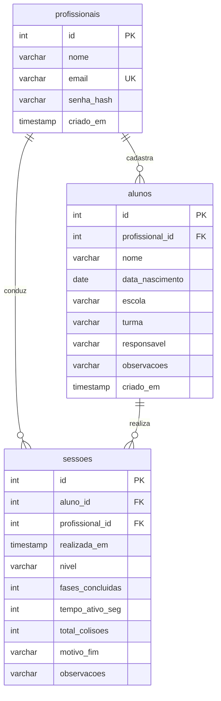

# Banco de dados

O Attobrain usa MySQL com três tabelas simples. O script `sql/attobrain.sql` é importado no phpMyAdmin do XAMPP (aba Importar).

## Como as tabelas são usadas

- **profissionais:** quem faz login. A senha nunca é salva em texto: guarda-se o hash do bcrypt. A conta local de demonstração aparece com o nome de Victor Gabriel Ferreira Theodoro e mantém o e-mail/senha de acesso documentados no README; ela não é uma conta institucional.
- **alunos:** o CRUD da tela **Alunos**. Cada aluno pertence a um profissional, que só enxerga os próprios cadastros.
- **sessoes:** um resumo por sessão do labirinto, gravado quando o profissional encerra a sessão. Excluir o aluno apaga também o histórico dele (`ON DELETE CASCADE`).

## O que NÃO vai para o banco

Trajetória do mouse, eventos e EEG sintético continuam na memória da sessão ativa e no JSON exportado. O banco guarda apenas o resumo, para manter o sistema simples.

Os dados acadêmicos estáveis do projeto (objetivo, base conceitual, referências e equipe) são conteúdo versionado da página **Projeto** no site. Eles não pertencem às tabelas operacionais `alunos` e `sessoes`. Os três alunos do script SQL continuam sendo cadastros fictícios de demonstração, identificados como tal.

## Consultar pelo terminal

No phpMyAdmin, abra o banco `attobrain` → tabela `sessoes` → **Procurar**, ou rode `SELECT * FROM sessoes;` na aba SQL.
